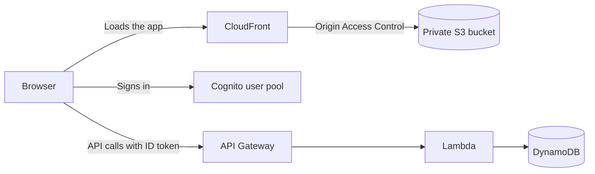

# Procuratio

A property listings manager for land, buildings, and rentals. It is a React and Tailwind CSS single-page app, hosted on AWS and backed by a serverless API. Access is limited to users that an administrator creates in Amazon Cognito.

**Live site:** https://d3ph8kghrwzfoa.cloudfront.net (sign-in required, no public sign-up)

The API this app calls is in [property-listings-api](https://github.com/KaTaBioDun/property-listings-api).

## Features

- Sign in and sign out with an email and password.
- Create, edit, and delete listings, and mark a listing as sold or reopen it.
- Search by title or location, filter by type and status, and sort by date or price.
- A header summary that adapts to the data, for example "2 of 6 listings are available, worth ₦90M."
- Form validation with inline errors, a delete confirmation, and success and error messages.
- Loading, empty, and error states, and a session that refreshes quietly until the refresh token expires.

## Architecture



| Layer | Technology |
|---|---|
| UI | React, Vite, Tailwind CSS |
| Hosting | Private Amazon S3 bucket behind Amazon CloudFront (HTTPS) |
| Authentication | Amazon Cognito user pool |
| API | API Gateway HTTP API with a JWT authorizer, Lambda, DynamoDB |
| Deployment | GitHub Actions with OpenID Connect (no stored AWS keys) |

## Sign-in flow

1. The user submits an email and password. The app calls Cognito's `InitiateAuth` operation with the `USER_PASSWORD_AUTH` flow.
2. Cognito returns an ID token, a refresh token, and an expiry time. The app stores them in `sessionStorage`, so closing the tab signs the user out.
3. Every API request carries the header `Authorization: Bearer <ID token>`.
4. Before each request, the app checks the expiry. When less than 60 seconds remain, it requests a new ID token with the refresh token.
5. If a refresh fails, or the API returns `401`, the app clears the session and shows the sign-in screen.

The logic is in `src/auth.js`, and the API client in `src/api.js` attaches the token.

## Project structure

```
property-listings-web/
├── .github/workflows/deploy.yml   # Build and deploy on every push to main
├── index.html
├── vite.config.js                 # Fixes the dev server on port 5173 (the CORS origin)
├── .env.example                   # Template for local settings
└── src/
    ├── main.jsx
    ├── App.jsx                    # State, API calls, page layout
    ├── api.js                     # API client that adds the token
    ├── auth.js                    # Cognito sign-in, token storage, refresh
    ├── index.css                  # Theme tokens and fonts
    ├── lib/
    │   └── format.js              # Constants, currency and date formats, shared styles
    └── components/
        ├── Login.jsx
        ├── ListingCard.jsx
        ├── ListingForm.jsx
        ├── Modal.jsx
        ├── Plan.jsx               # Illustration for each property type
        ├── Segmented.jsx          # Filter chips
        └── Select.jsx             # Dropdown with a custom arrow
```

## Configuration

Vite reads these variables at build time and embeds them in the app. They are identifiers, not secrets.

| Variable | Required | Description |
|---|---|---|
| `VITE_API_URL` | Yes | API Gateway invoke URL, with no trailing slash |
| `VITE_COGNITO_CLIENT_ID` | Yes | ID of the Cognito app client |
| `VITE_COGNITO_REGION` | No | Region of the user pool. Defaults to `eu-west-2` |

## Run locally

Prerequisites: Node.js and a deployed copy of the API.

```bash
npm install
cp .env.example .env     # then fill in your values
npm run dev
```

Open `http://localhost:5173`. The dev server is fixed to port 5173 with `strictPort`, because the API's CORS configuration allows that exact origin. Restart the server after changing `.env`.

## Build and deploy

On every push to `main`, `.github/workflows/deploy.yml` runs these steps:

| Step | What it does |
|---|---|
| Install | `npm ci` |
| Build | `npm run build`, using the repository variables `VITE_API_URL` and `VITE_COGNITO_CLIENT_ID`. The step fails if either is missing |
| Authenticate | Exchanges a GitHub-issued OIDC token for temporary credentials on the IAM role `github-actions-listings-web-deploy` |
| Upload | `aws s3 sync dist` to the bucket, with `--delete` so files that are no longer in the build are removed |
| Invalidate | Creates a CloudFront invalidation for `/*` |

The IAM role's trust policy accepts tokens only from this repository's `main` branch. Its permissions policy allows `s3:ListBucket`, `s3:PutObject`, and `s3:DeleteObject` on one bucket, and `cloudfront:CreateInvalidation` on one distribution.

To set up hosting from scratch:

1. Create a private S3 bucket with Block Public Access on.
2. Create a CloudFront distribution with the bucket as origin, Origin Access Control, and `index.html` as the default root object.
3. Create the IAM policy and role described above.
4. Add the repository variables `VITE_API_URL` and `VITE_COGNITO_CLIENT_ID` (Settings, Secrets and variables, Actions, Variables).
5. Add the CloudFront domain to the API's allowed CORS origins.

## Design

- Light theme in deep green and white, with Sora for headings and Albert Sans for text.
- A centered grid of cards. Each card has an illustration drawn for its type: a plot with trees for land, a tower for buildings, and a house for rentals.
- Sold listings fade to grey and carry a dark "Sold" badge.
- Dialogs use the native `<dialog>` element, form fields have labels, and focus is visible for keyboard use.

## Limitations

- **One level of access.** Every signed-in user can edit every listing. There are no roles.
- **Tokens in `sessionStorage`.** They are readable by any script on the page. The app loads no third-party scripts, and the only external resource is Google Fonts.
- **No second factor.** Sign-in uses a password only.
- **Light theme only.** There is no dark mode.
- **Default CloudFront domain.** The site has no custom domain.
- **No automated tests.** Behavior was checked by hand and with a build and lint pass.

## Roadmap

- [ ] Add a custom domain with Route 53 and ACM.
- [ ] Add multi-factor authentication in Cognito.
- [ ] Add roles so only some users can edit.
- [ ] Add tests for the sign-in logic and the listing form.
- [ ] Define the S3 bucket, CloudFront distribution, and IAM role as code.

## What I learned

- **Environment variables are baked in at build time.** Vite reads `.env` only when the dev server starts, and a deployed build only has the values that GitHub Actions passes in, so the same values must exist as repository variables.
- **Each origin must be allowed in CORS.** Moving from `localhost:5173` to the CloudFront domain required adding the new origin, and adding sign-in required allowing the `authorization` header.
- **Check what was committed, not what is on disk.** A change that is saved locally but missing from the commit never reaches the pipeline. `git show HEAD:<file>` shows exactly what was pushed.
- **A Git repository belongs at the project level.** Running `git init` in a parent folder created a repository around two separate projects, and `git rev-parse --show-toplevel` showed where the repository really started.
- **A login screen is not security on its own.** The authorizer on the API is what rejects requests without a valid token.
- **Accessible dropdowns need a replaced arrow, not a hidden one.** A native `<select>` keeps its keyboard behavior when only the arrow is restyled.

## Author

Arogundade Hammed A., frontend developer.

- GitHub: [KaTaBioDun](https://github.com/KaTaBioDun)
- LinkedIn: [hammed-arogundade](https://www.linkedin.com/in/hammed-arogundade-62b350255/)
- Email: arohammed0.1@gmail.com
