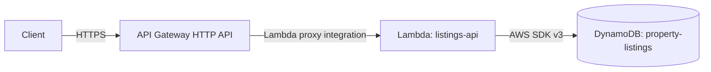

# Property listings API

A serverless REST API for managing property listings, built on AWS with API Gateway, Lambda, and DynamoDB. It supports create, read, update, and delete (CRUD) operations on listings for land, buildings, and rentals.

## Overview

| Item | Value |
|---|---|
| API type | Amazon API Gateway HTTP API |
| Compute | One AWS Lambda function (`listings-api`), Node.js, ES modules |
| Database | Amazon DynamoDB table `property-listings`, on-demand capacity |
| Region | `eu-west-2` (London) |
| Base URL | `https://<API-ID>.execute-api.eu-west-2.amazonaws.com` |
| Authentication | None (see [Limitations](#limitations)) |

## Architecture



**Request flow**

1. The client sends an HTTPS request to the API Gateway base URL.
2. API Gateway matches the method and path to one of five routes and invokes the Lambda function with an event that includes `routeKey`, `pathParameters`, and `body`.
3. The function reads `routeKey`, validates the input, and runs one DynamoDB operation.
4. The function returns a JSON response with a status code. API Gateway passes it back to the client.

## Data model

Table `property-listings`, partition key `listingId` (String). No sort key.

| Attribute | Type | Set by | Rules |
|---|---|---|---|
| `listingId` | String | Server | UUID generated on create |
| `title` | String | Client | Required, non-empty |
| `location` | String | Client | Required, non-empty |
| `price` | Number | Client | Required, 0 or more |
| `type` | String | Client | Required. One of `land`, `building`, `rental` |
| `status` | String | Client | Optional on create (default `available`). One of `available`, `sold` |
| `createdAt` | String | Server | ISO 8601 timestamp, set on create |
| `updatedAt` | String | Server | ISO 8601 timestamp, set on update |

## API reference

All request and response bodies use JSON. Send `Content-Type: application/json` with a body.

| Method | Path | Description |
|---|---|---|
| `POST` | `/listings` | Create a listing |
| `GET` | `/listings` | List all listings, newest first |
| `GET` | `/listings/{id}` | Get one listing |
| `PUT` | `/listings/{id}` | Update one or more fields of a listing |
| `DELETE` | `/listings/{id}` | Delete a listing |

### Create a listing

```bash
curl -X POST "$API_URL/listings" \
  -H "Content-Type: application/json" \
  -d '{"title":"Corner plot, 600 sqm","location":"Lekki, Lagos","price":45000000,"type":"land"}'
```

Response `201 Created`:

```json
{
  "listingId": "<generated UUID>",
  "title": "Corner plot, 600 sqm",
  "location": "Lekki, Lagos",
  "price": 45000000,
  "type": "land",
  "status": "available",
  "createdAt": "<ISO 8601 timestamp>"
}
```

### List all listings

```bash
curl "$API_URL/listings"
```

Response `200 OK`: a JSON array of listings, sorted by `createdAt` with the newest first. The function reads the full table with a paginated `Scan`.

### Get a listing

```bash
curl "$API_URL/listings/<listingId>"
```

Response `200 OK`: the listing object. Response `404 Not Found` if no listing has that ID.

### Update a listing

```bash
curl -X PUT "$API_URL/listings/<listingId>" \
  -H "Content-Type: application/json" \
  -d '{"status":"sold"}'
```

The body must contain at least one of `title`, `location`, `price`, `type`, `status`. Fields that are not sent keep their current values. Other fields in the body are ignored. The function sets `updatedAt` and returns the full updated listing with `200 OK`. If no listing has that ID, it returns `404 Not Found` and does not create one.

### Delete a listing

```bash
curl -X DELETE "$API_URL/listings/<listingId>"
```

Response `200 OK` with `{"message":"Listing deleted"}`. Deleting an ID that does not exist returns `404 Not Found`.

### Errors

Errors return a JSON body with a `message` field.

| Status | Cause |
|---|---|
| `400 Bad Request` | The body is not valid JSON, a required field is missing, a value fails validation, or an update has no valid fields |
| `404 Not Found` | The listing does not exist, or the route is not recognized by the function |
| `500 Internal Server Error` | An unexpected error in the function. Details are written to CloudWatch Logs |

Requests to a method and path that are not one of the five routes receive `{"message":"Not Found"}` from API Gateway before they reach the function.

## Permissions

The Lambda execution role has the AWS-managed basic logging permissions plus this inline policy, which allows five actions on this one table:

```json
{
  "Version": "2012-10-17",
  "Statement": [
    {
      "Sid": "ListingsTableAccess",
      "Effect": "Allow",
      "Action": [
        "dynamodb:PutItem",
        "dynamodb:GetItem",
        "dynamodb:Scan",
        "dynamodb:UpdateItem",
        "dynamodb:DeleteItem"
      ],
      "Resource": "arn:aws:dynamodb:eu-west-2:<ACCOUNT-ID>:table/property-listings"
    }
  ]
}
```

## Repository structure

```
property-listings-api/
├── index.mjs        # Lambda handler: routing, validation, DynamoDB operations
├── smoke-test.sh    # End-to-end test against a deployed API
└── README.md        # This file
```

## Deploy

Resources were created in the AWS console, in this order.

1. **DynamoDB.** Create the table `property-listings` with partition key `listingId` (String) and **On-demand** capacity.
2. **Lambda.** Create a Node.js function named `listings-api`. Paste the contents of `index.mjs` and choose **Deploy**.
3. **IAM.** Open the function's execution role and add the inline policy from [Permissions](#permissions).
4. **API Gateway.** Create an **HTTP API** named `property-listings-api` with a Lambda integration for `listings-api`. Add these routes, all pointing to the same integration: `POST /listings`, `GET /listings`, `GET /listings/{id}`, `PUT /listings/{id}`, `DELETE /listings/{id}`. Use the stage `$default` with automatic deployment enabled.
5. Copy the **Invoke URL** from the stage details.

The path parameter must be named `id`, because the function reads `event.pathParameters.id`.

## Test

`smoke-test.sh` runs one full cycle against a deployed API and prints `PASS` or `FAIL` for each check:

```bash
bash smoke-test.sh https://<API-ID>.execute-api.eu-west-2.amazonaws.com
```

| Check | Expected status |
|---|---|
| Create listing | 201 |
| Reject invalid `type` | 400 |
| List listings | 200 |
| Get listing | 200 |
| Update listing | 200, and `status` is `sold` |
| Delete listing | 200 |
| Get deleted listing | 404 |
| Delete again | 404 |

The script creates its own listing and deletes it, so existing data is not changed. It exits with code 0 only if every check passes.

## Limitations

- **No authentication.** Anyone with the base URL can create, change, and delete listings.
- **No CORS configuration.** Browsers block calls from a web page on another origin until CORS is enabled on the API.
- **Full-table scan for listing.** `GET /listings` reads every item. This is acceptable for a small table and does not scale to large ones. There is no filtering or pagination in the API.
- **Console deployment.** Resources are not yet defined as infrastructure as code, and Lambda code is deployed by pasting it into the console.
- **Cost.** At this project's request volume, Lambda and DynamoDB usage is small. API Gateway HTTP API charges per request and is not part of the free tier for accounts on the AWS Free plan. Check the Billing console and current AWS pricing.

## Roadmap

- [ ] Enable CORS on the API.
- [ ] Add a React and Tailwind CSS frontend, hosted on S3 and CloudFront.
- [ ] Add sign-up and sign-in with Amazon Cognito, and require a valid token on write routes.
- [ ] Deploy the Lambda code with GitHub Actions.
- [ ] Define the resources in Terraform or AWS CDK.

## What I learned

- **How listing IDs work.** The function generates a unique `listingId` when a listing is created, and the create response returns it. Get, update, and delete all need that ID. It goes in the URL path (`/listings/<listingId>`) or, in a Lambda test event, in `pathParameters`. When an ID does not match a stored listing, the function returns `404` with `Listing not found`, which means the route worked and the lookup found nothing.
- **Test events versus functions.** A Lambda test event is a saved sample input for the function. It does not create anything in AWS.
- **Two kinds of "deploy".** Editing Lambda code takes effect only after choosing **Deploy** in the Lambda console. API Gateway with automatic deployment republishes route changes on its own.
- **Path parameter names must match.** The route `/listings/{id}` and the code `event.pathParameters.id` must use the same name.
- **A 404 can come from different layers.** API Gateway returns `{"message":"Not Found"}` for an undefined route, while the function returns `Listing not found` for a missing ID.
- **Reserved words in DynamoDB.** The update expression uses `#name` placeholders because `location`, `status`, and `type` are DynamoDB reserved words.

## Author

BioDun, frontend developer.

- GitHub: [KaTaBioDun](https://github.com/KaTaBioDun)
- LinkedIn: [hammed-arogundade](https://www.linkedin.com/in/hammed-arogundade-62b350255/)
- Email: arohammed0.1@gmail.com
